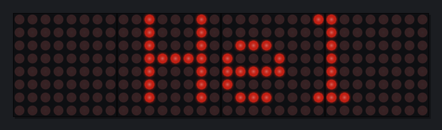

# MAX7219 LED matrix simulator

Run your ESP32 Arduino sketch for MAX7219 8×8 modules (`Max72xxPanel` + `Adafruit_GFX`) on your PC and watch the LEDs in a window — no hardware needed. Your `.ino` compiles **unchanged**: the same file you upload to the ESP32.



## How it works

The real `Max72xxPanel` and `Adafruit_GFX` libraries are compiled on your PC against a fake Arduino core. Instead of a real SPI bus, every byte your code sends goes into an emulation of a chain of MAX7219 chips (shift registers, digit registers, intensity, shutdown, scan limit, decode mode and display test). The window draws what those chips would light up.

Because it emulates the chips rather than the library, the simulator also catches wiring mistakes: if `setPosition()` / `setRotation()` don't match how your modules are mounted, the picture comes out scrambled exactly as it would on the hardware.

## Setup on Windows (one time)

1. Install **MSYS2** from https://www.msys2.org (default folder `C:\msys64`).
2. Open the **"MSYS2 UCRT64"** terminal and run:
   ```
   pacman -S --needed mingw-w64-ucrt-x86_64-gcc mingw-w64-ucrt-x86_64-cmake mingw-w64-ucrt-x86_64-ninja mingw-w64-ucrt-x86_64-SDL2
   ```
3. Unzip this folder anywhere, e.g. `C:\max7219-sim`.

Then, from a normal Command Prompt or PowerShell in that folder:

```
sim.bat examples\Demo
sim.bat C:\Users\you\Documents\Arduino\MyMatrix
```

`sim.bat` builds the sketch (a few seconds; only changed files are rebuilt) and opens the simulator window. Run it again after editing your `.ino`.

## Setup on Linux / macOS

Install a C++ compiler, CMake and SDL2 (`sudo apt install build-essential cmake libsdl2-dev`, or `brew install cmake sdl2`), then:

```
./sim.sh examples/Demo
./sim.sh ~/Arduino/MyMatrix --modules 4x1
```

If SDL2 isn't installed, CMake downloads and builds it automatically the first time. Without any SDL2 the matrix is drawn in the terminal instead.

## Using it from VS Code + PlatformIO

The simulator can run as an extra PlatformIO environment in your existing ESP32 project, so you switch between the real board and the simulator from the PlatformIO toolbar.

1. Copy this whole folder into your project as `simulator/` (next to `src/` — **not** inside `lib/`).
2. Add a `sim` environment to `platformio.ini` (full example in `platformio/platformio.ini.example`):
   ```ini
   [env:sim]
   platform = native
   lib_deps = ${env:esp32dev.lib_deps}   ; same library versions as the real build
   lib_ignore = Adafruit BusIO           ; hardware I2C/SPI helpers, not used by MAX7219 code
   lib_compat_mode = off                 ; let Arduino libraries build without framework = arduino
   extra_scripts = pre:simulator/platformio/sim.py
   custom_sim_args = --modules 4x1 --button 0=space
   ```
   Replace `esp32dev` with the name of your ESP32 environment. The simulator then compiles the same Adafruit GFX and Max72xxPanel versions as your real build. When building for the simulator, the build script leaves out the OLED/TFT drivers inside Adafruit GFX, which need real SPI/I2C hardware. If you'd rather use the copies bundled in `libraries/`, write `lib_deps =` with nothing after it. Your ESP32 environment doesn't change.
3. **Windows only:** `platform = native` uses the GCC on your PATH. Install MSYS2 and the packages from "Setup on Windows" above, add `C:\msys64\ucrt64\bin` to your Windows PATH, then restart VS Code.
4. In the PlatformIO sidebar, open **sim → Custom → Simulate**. It builds and opens the window, and the task terminal works as your Serial monitor. From a terminal: `pio run -e sim -t simulate`.

Simulator options go in `custom_sim_args`, or in `// sim: ...` comments anywhere in `src/`. The program is built to `.pio/build/sim/program(.exe)` if you want to run it yourself with extra options.

## Using it

- **Window title** shows the module count, brightness and how often your sketch updates the display. Hover over an LED to see its x/y coordinate and which chip, digit and bit drive it.
- **Serial**: `Serial.print` output appears in the terminal. Type a line there and press Enter to send it to `Serial.read()` / `readStringUntil()`.
- **Buttons**: `--button 0=space` makes holding Space press a button on GPIO0 (pulled to GND for `INPUT_PULLUP`, to 3.3 V for `INPUT_PULLDOWN`). Add as many as you need.
- **Joystick**: `--axis 34=left,right` makes `analogRead(34)` return 0 / 2048 / 4095.
- **Esc** or closing the window stops the simulator.

### Options

| Option | What it does |
|---|---|
| `--modules WxH` | Physical grid of modules, e.g. `4x1` or `4x2` (default: all chips in one row) |
| `--rtl` | Chip 0 (wired to the ESP32) is at the right end of the row |
| `--serpentine` | Rows alternate direction (zig-zag wiring) |
| `--rotate N` | Every module is physically turned N × 90° (0–3) |
| `--button PIN=KEY` | Key held = button pressed. Keys: `a`–`z`, `0`–`9`, `space`, `enter`, `up`, `down`, `left`, `right`, `shift`, `ctrl`, `tab` |
| `--axis PIN=LOW,HIGH` | Two keys drive an analog input |
| `--color C` | `red` (default), `green`, `blue`, `yellow`, `white`, `orange`, or `RRGGBB` |
| `--speed X` | Run sketch time X× faster (`0.25` = slow motion for debugging animations) |
| `--pitch N` | LED spacing in pixels |
| `--console` | Draw in the terminal instead of a window |
| `--headless --run-ms N --screenshot out.bmp` | Run without a window and save a picture (handy for automated tests) |

You can keep options inside the sketch as a comment, which the Arduino IDE ignores:

```cpp
// sim: --modules 4x1 --button 0=space
```

### Matching your real modules

By default the simulator wires the modules the way `Max72xxPanel` assumes when you call neither `setPosition()` nor `setRotation()`. If your hardware needs those calls (common with 4-in-1 "FC-16" boards), tell the simulator how your modules are actually mounted — for example `--rtl --rotate 1` — and your existing `setPosition`/`setRotation` code should then give an upright picture in the simulator, just like on the hardware. If it's scrambled in the simulator with the right wiring options, it'll be scrambled on the ESP32 too.

## What's supported

- Arduino IDE sketch rules: multiple `.ino` tabs, functions used before they're defined (prototypes are generated, default arguments included), `.cpp`/`.h` files next to the sketch, `PROGMEM`, `F()`, `B01010101` constants, `String`, `Serial.printf`, `millis`/`delay`/`random`/`map`.
- `Adafruit_GFX` drawing, `print()`, bitmaps and the custom fonts in `Fonts/`.
- Other MAX7219 libraries that use `SPI.transfer()` or `shiftOut()` (e.g. LedControl, MD_MAX72xx): drop the library folder into `libraries/`. These aren't bundled or tested.
- Several chains on different CS pins are shown stacked.

Not simulated: WiFi, Bluetooth, I2C devices, interrupts and FreeRTOS tasks. Code using them needs `#ifndef MAX7219_SIMULATOR` around those parts (the simulator defines `MAX7219_SIMULATOR`).

Note that `ESP32` is defined, `int` is 32-bit like on the ESP32, and `millis()` wraps at 32 bits as on the real board.

## Folder layout

```
core/        fake Arduino/ESP32 core (Arduino.h, SPI, Serial, String, ...)
sim/         MAX7219 chain emulation, window, renderer
tools/       sketchgen: turns .ino files into C++ the way the Arduino IDE does
platformio/  PlatformIO build script (sim.py) and an example platformio.ini
libraries/   Adafruit_GFX and Max72xxPanel (unmodified copies, see their license.txt)
examples/    Demo plus the four Max72xxPanel examples
```

Building by hand: `cmake -B build -DSKETCH=path/to/sketch && cmake --build build`.

Tested with GCC and Clang on Linux, with a MinGW Windows build, and through PlatformIO's native platform on Linux. The PlatformIO setup on Windows and Visual Studio (MSVC) haven't been tested.

The bundled libraries in `libraries/` are unmodified copies, used by `sim.bat`/`sim.sh` and by PlatformIO when the sim environment has no `lib_deps`.
